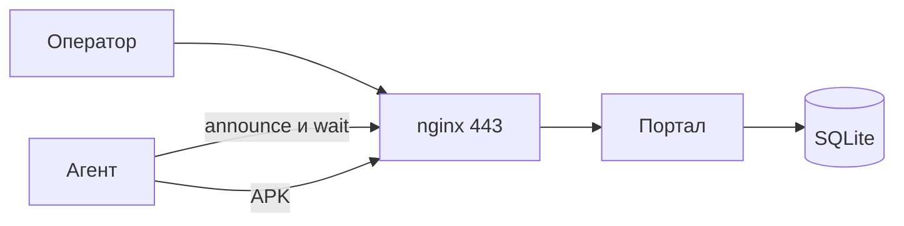
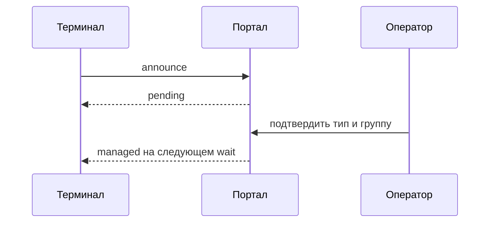
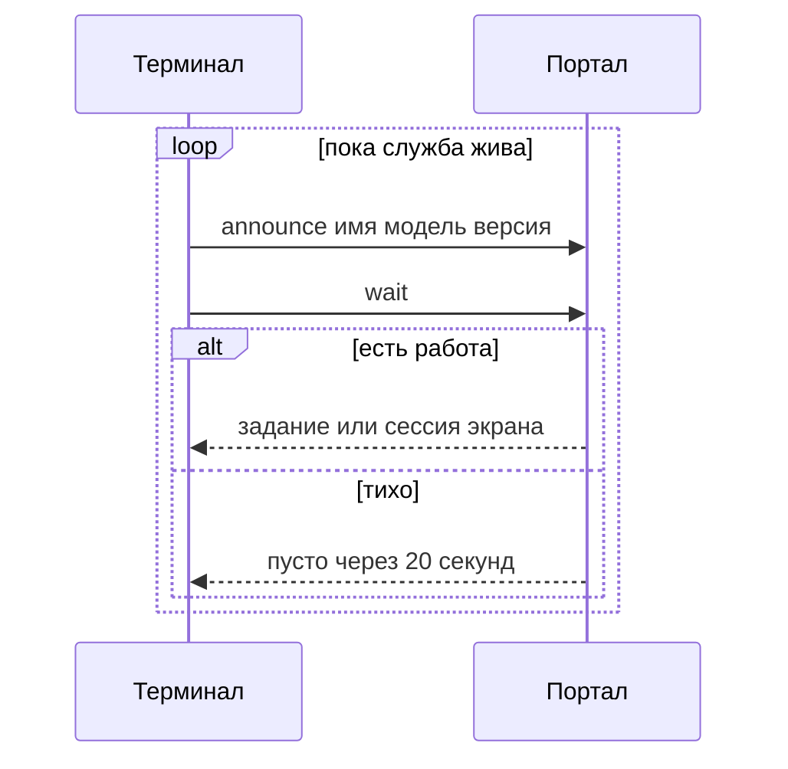
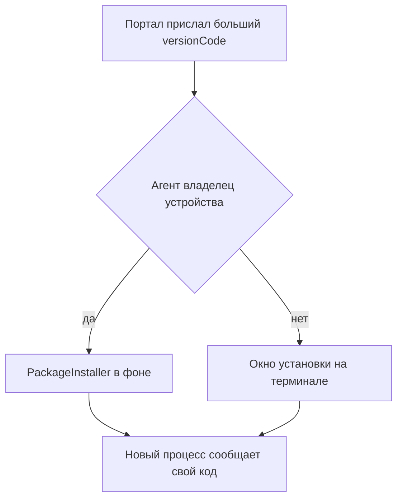
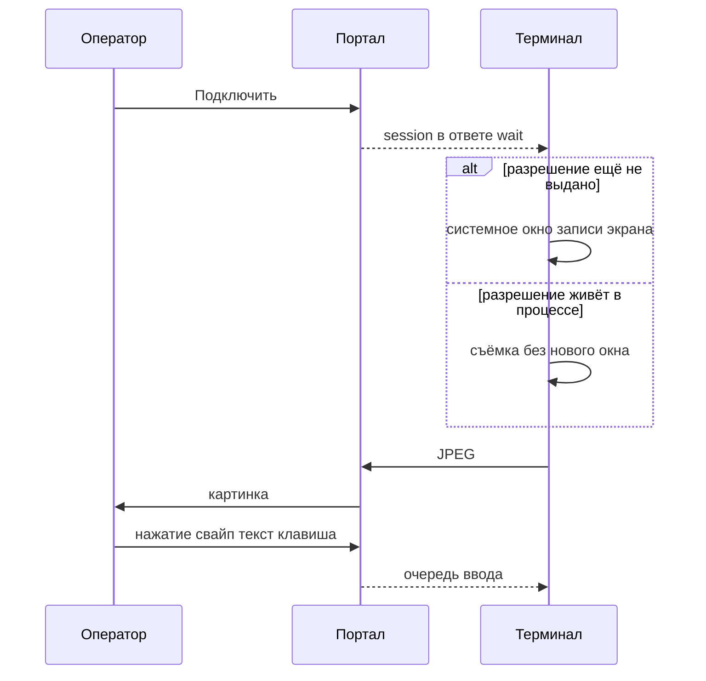

# Диспетчер

Централизованное управление и настройка терминалов сбора данных в корпоративной сети. Оператор подтверждает аппарат, назначает пакеты и смотрит его экран. На терминале стоит один агент: он сам выходит на портал и ставит остальное.

Репозиторий один и тот же в двух местах:

- https://github.com/Andry495/mdm-tsd
- https://gitlab.bytplast.ru/bytplast/business-apps/mdm-tsd

Площадка Бытпласт: имя `mdm-tsd`, адрес `192.168.10.205`.

| Часть | Каталог | Что делает |
|---|---|---|
| Портал | [tsd-server](tsd-server/README.md) | Браузер оператора, каталог пакетов, карточки устройств, живой экран |
| Агент | [tsd-agent](tsd-agent/README.md) | Приложение `ru.bytplast.tsdagent` на терминале или телефоне |
| Протокол | [tsd-server/PROTOCOL.md](tsd-server/PROTOCOL.md) | Сообщения между ними |

Каталог `Печать_этикеток` и скрипты `scanner_diag*.ps1` к Диспетчеру не относятся. Портал не входит в обмен 1С и не хранит публикацию `nasklade`.

## Из чего состоит

Портал — ASP.NET Core 8 за nginx, данные в SQLite. Агент — Kotlin, Android 10 и новее. Связь строится исходящими запросами агента: терминал сам открывает HTTPS, портал отвечает заданием или сессией экрана. Входящий TCP с портала на аппарат (`8741` обнаружение, `8742` команды) остаётся запасным путём и из другой подсети обычно не доходит.

Уникальный ключ аппарата — `deviceId`, случайный UUID, который агент хранит у себя. Имя из настроек Android (`Settings.Global.DEVICE_NAME`) — подпись той же карточки. Смена имени на терминале меняет заголовок в списке, на карточке и в шторке уведомления. Номер карточки остаётся прежним.

Повторная карточка после переустановки схлопывается, если совпал Android ID, серийный номер или пара «модель и адрес» при молчании старой карточки дольше 10 минут. Управление, семейство и группа переносятся со старой карточки, если новая ещё не подтверждена.

## Жизнь терминала

### Первое появление

Агент ставится из магазина портала в браузере самого терминала: `https://192.168.10.205/`. Пока в приложении нет адреса, отпечатка сертификата и номера устройства, на экране настройки есть кнопка «Сообщить порталу». После этого служба поднимается сама: при загрузке аппарата и после замены пакета.

Состояния карточки: `pending`, `managed`, `rejected`. Пакеты и экран доступны только `managed`. Удаление карточки — кнопка в списке устройств. Если агент на аппарате ещё работает, следующая связь создаст новую неподтверждённую карточку.

### Постоянная связь

Служба агента по кругу шлёт `announce`, затем длинный `wait`. В `wait` уходят код версии, Android ID, имя терминала, фазы обновления и экрана и короткий журнал. Портал держит пустой `wait` до 20 секунд, чтобы не крутить запросы вхолостую.

### Обновление агента

Свой пакет `ru.bytplast.tsdagent` портал предлагает сам, как только в каталоге есть назначаемая версия с большим `versionCode`, чем сообщил аппарат. Отдельная кнопка оператора для этого не нужна. Чужие пакеты ставятся только явным заданием, обычно через назначение группе.

Успех — код версии, который сообщит уже новый процесс. Умирающий процесс свою установку успехом не отмечает.

Владелец устройства ставит пакет без диалога и без вывода агента на весь экран. Результат установки приходит в фоновый приёмник. Если владельца нет, агент ищет службу производителя `android.device.DeviceManager` (её ставят Chainway и Urovo) и просит её поставить пакет без окна. Когда такой службы нет, открывается окно установки. На Android 10 и новее система часто не показывает это окно из фона, а при погашенном экране человек его не видит.

Стать владельцем уже настроенный аппарат сам не может. Агент при старте пробует это один раз и пишет в журнал «агент уже владелец устройства» либо «владелец при установке не назначен». Сброса к заводским настройкам агент не делает.

### Экран

Оператор открывает сессию со страницы устройства. Портал держит её в памяти процесса: перезапуск контейнера сессию закрывает, на диск кадры не пишутся.

Запись экрана Android выдаёт только после согласия на терминале. Владелец устройства это согласие заранее выдать не может. Пока процесс агента жив, повторное «Подключить» окно не показывает. Обновление агента и перезагрузка терминала разрешение стирают: оно не записывается в файл.

Нажатия и свайпы исполняет служба специальных возможностей «Агент ТСД». Координаты считаются по полному кадру, включая нижнюю полосу, если она нарисована на экране. Если полосы нет и кнопки физические, под картинкой на портале стоят те же три клавиши: назад, домой, недавние. Они вызывают системные действия, а не точку на кадре. Если терминал повернули после «Подключить», агент перестраивает кадр под новую сторону. Чёрные поля от старого поворота не остаются.

Кнопки «Подключить» и «Отключить» меняют цвет по состоянию сессии. Пока сессия открыта, цветом отмечена «Отключить».

Погашенный экран агент включить не может: короткое нажатие питания — системная клавиша. Снять блокировку с пин-кодом, паролем или графическим ключом стороннее приложение тоже не может. Чёрный кадр в портале в этом случае — выключенный или закрытый экран, а не пустой рабочий стол.

## Что оператор видит

| Страница | Зачем |
|---|---|
| `/` | Магазин. Первая установка агента с самого терминала |
| `/login` | Вход |
| `/devices` | Список: имя, адрес, состояние, версия агента, связь, удаление |
| `/devices/{id}` | Карточка: имя, модель, фазы, журнал канала |
| `/devices/{id}/screen` | Живой экран, клавиши, текст |
| `/catalog` | Актуальные пакеты. Название открывает карточку |
| `/catalog/{id}` | Карточка пакета: текущая версия и до семи предыдущих |

Роли портала: `admin`, `operator`, `viewer`.

В списке каталога у пакета одна строка — старшая версия. Прошлые версии живут на карточке и ограничены семью. Всё, что старше, портал удаляет сам: и строку в базе, и файл APK. Очистка идёт при старте портала и сразу после загрузки нового APK. Незавершённое задание на удалённую версию закрывается, назначение группы переносится на актуальную.

Чужой пакет, в том числе мобильная платформа 1С `com.e1c.mobile`, кладётся в каталог тем же полем «Загрузить APK». Магазин показывает его кнопкой «Скачать». Портал сам не ходит в Google Play и на releases.1c.ru: у Play нет этого пакета, а сборки платформы 1С лежат за входом в учётную запись 1С. Файлы информационной базы 1С портал не раздаёт.

## Чего нет

Конструктора макросов, записи действий оператора и доставки настроек 1С через портал в коде нет. Удалённый экран — опрос JPEG и очередь ввода, не постоянный канал. Лицензии и справочник оборудования 1С агент не меняет. Автоматической подтяжки новых сборок 1С из внешнего магазина нет.
